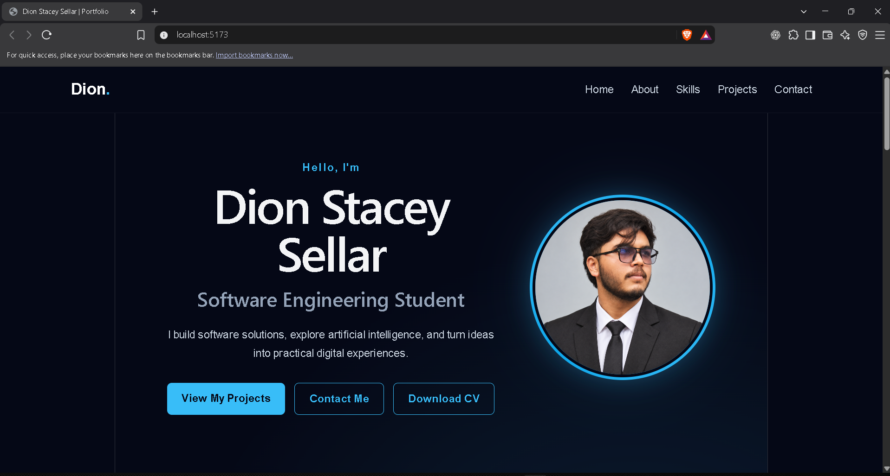
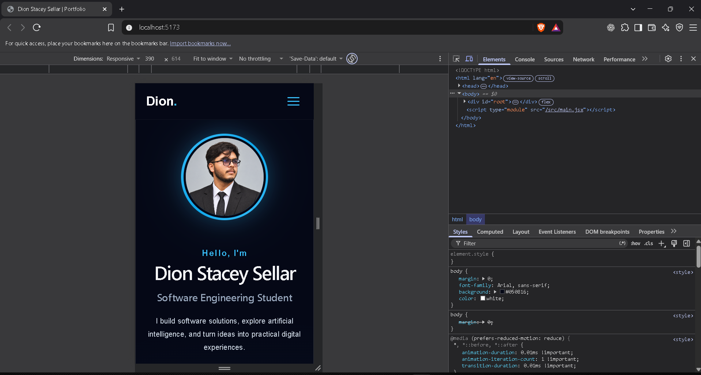

# Dion Stacey Sellar — Portfolio

A responsive personal portfolio showcasing my software development work, AI projects, technical skills, and academic background.

**[🌐 View Live Portfolio](https://dion-portfolio-sigma.vercel.app)** · **[🤖 JARVIS Demo Page](https://dion-portfolio-sigma.vercel.app/jarvis-demo)** · [GitHub Profile](https://github.com/dionstacey03-dev) · [LinkedIn](https://www.linkedin.com/in/dion-stacey-sellar-1066a7339/)

## About

I'm a Software Engineering student at NSBM Green University, studying for a BSc in Software Engineering awarded by the University of Plymouth. I enjoy building practical applications, experimenting with AI, and improving my development skills through hands-on projects.

The portfolio includes my background, skills, featured projects, and contact details. It also provides responsive navigation and a downloadable CV.

## Built With

- React 19
- JavaScript
- CSS
- Vite 8
- ESLint
- Vercel for production deployment

## Featured Projects

| Project | Description | Links |
| --- | --- | --- |
| **JARVIS AI Assistant** | A Python desktop assistant featuring voice interaction, speech recognition, text-to-speech, and AI responses using Ollama. | [GitHub Repository](https://github.com/dionstacey03-dev/JARVIS-AI-Assistant) · [Portfolio Demo Page](https://dion-portfolio-sigma.vercel.app/jarvis-demo) |
| **AI Smart Tourism Planner** | A Sri Lanka travel-planning concept designed to help users explore destinations and consider travel conditions. | [Live Demo](https://ai-smart-tourism-planner.vercel.app) · [GitHub Repository](https://github.com/dionstacey03-dev/AI-Smart-Tourism-Planner) |

## Skills

- **Languages:** Python, JavaScript, SQL
- **Frontend:** React, HTML, CSS, Vite
- **Tools:** Git, GitHub, VS Code
- **Areas of interest:** Artificial Intelligence, software development, and building useful digital products

## Run Locally

You'll need [Node.js](https://nodejs.org/) and npm installed.

```bash
git clone https://github.com/dionstacey03-dev/Dion-Portfolio-.git
cd Dion-Portfolio-
npm install
npm run dev
```

Open the local URL printed by Vite.

### Available Scripts

```bash
npm run dev      # Start the development server
npm run lint     # Check the source with ESLint
npm run build    # Build the production version in dist/
npm run preview  # Preview the production build locally
```

## Deployment

The portfolio is deployed to Vercel:

**Production URL:** https://dion-portfolio-sigma.vercel.app

The project uses Vite. The standard production build command is `npm run build`, and the build output directory is `dist`.

## Screenshots

### Desktop



### Mobile



## Contact

- [LinkedIn](https://www.linkedin.com/in/dion-stacey-sellar-1066a7339/)
- [GitHub](https://github.com/dionstacey03-dev)
- Email: [dion.stacey.03@gmail.com](mailto:dion.stacey.03@gmail.com)
